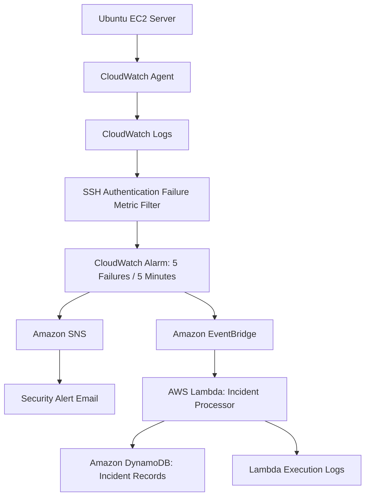

# Multi-Cloud SOC Architecture

## AWS Security Monitoring and Incident Processing

## Detection Workflow

1. An Ubuntu EC2 instance generates SSH authentication events.
2. CloudWatch Agent forwards security logs to CloudWatch Logs.
3. A metric filter identifies failed or invalid SSH authentication attempts.
4. A CloudWatch alarm evaluates the failure count over five-minute periods.
5. Amazon SNS delivers email notifications when the alarm activates.
6. EventBridge routes matching alarm-state changes to AWS Lambda.
7. Lambda creates a structured incident record.
8. DynamoDB stores the incident using its unique incident ID.

## Security Controls

- IAM roles provide AWS service access.
- Lambda has table-specific DynamoDB write permissions.
- Conditional writes prevent duplicate incident records.
- EC2 security groups restrict network access.
- Automated IP blocking is not enabled.

## Validation Status

- Real SSH authentication events successfully triggered CloudWatch and SNS alerts.
- EventBridge successfully invoked Lambda during a controlled alarm test.
- Lambda successfully stored a test incident in DynamoDB.
- **End-to-end AWS validation passed (October 25, 2026 UTC):** Six controlled SSH authentication failures were ingested into CloudWatch Logs, triggering the CloudWatch alarm at 02:06:45 UTC.
- Lambda executed successfully and logged `SOC_INCIDENT_STORED`.
- A matching new incident was independently confirmed in DynamoDB.
- EventBridge is the configured routing path, but its delivery metrics were not independently verified for this test.

## Current Limitations

The CloudWatch metric counts authentication failures across the monitored instance, rather than by individual source IP.

The separate Bash detection prototype analyzes simulated SSH events and is not part of the CloudWatch detection pipeline.

Microsoft Azure integration and cross-cloud incident correlation are planned but not yet implemented.
